# xone-relay

`xone-relay` forwards controller input and force feedback between a host system running
the xone driver and a separate Linux system that receives controller input over the network.

```mermaid
graph LR
    %% Setup clean, flat shapes with outline-only styling
    classDef minimal fill:none,stroke:#888,stroke-width:1.5px,color:inherit
    classDef highlight fill:none,stroke:#107C10,stroke-width:2px,color:inherit

    subgraph Controller ["Controller"]
        direction TD
        XB[Xbox Controllers]:::highlight
    end

    subgraph Host ["Host"]
        direction TD
        AD[Xbox Wireless Adapter]:::minimal
        EV["/dev/input/eventN<br>(evdev, FF_RUMBLE)"]:::minimal
        XRS["xone-relay (sender)"]:::minimal

        AD -- xone --> EV
        EV --> XRS
    end

    subgraph Receiver ["Receiver / Client"]
        direction TD
        XRR["xone-relay (receiver)"]:::minimal
        UI[uinput Xbox Controller]:::minimal
        ST[Steam / Games]:::highlight

        XRR --> UI
        UI --> ST
    end

    XB -. "2.4 GHz" .-> AD
    XRS -. "TCP 47998" .-> XRR

    style Controller fill:none,stroke:#444,stroke-dasharray: 5 5
    style Host fill:none,stroke:#444,stroke-dasharray: 5 5
    style Receiver fill:none,stroke:#444,stroke-dasharray: 5 5
```



## Features

- **Multiple controllers:** connect up to eight controllers. Each one appears
  on the receiver as its own controller.
- **Rumble:** force feedback from games is relayed back to the controller.
- **Reconnects:** a sleeping controller, a replugged adapter, or a restarted
  receiver recovers without restarting the relay.
- **Low latency:** responsive input over a wired local network.
- **Self-contained:** one static binary and one small configuration file. The
  receiver needs no Python, evdev, or udev runtime packages.
- **Hot-plug:** controllers can come and go while the relay is running.

## Build

```sh
./build.sh
```

This uses podman or docker with the pinned Rust image to run the tests and
build `dist/xone-relay`. CI runs the same format, lint, test, and static-build
steps. A tagged release carries the binary and its checksum.

Native development:

```sh
cargo test
cargo build --release
```

## Install

### On the sender system

#### Requirements

- `xone` installed from [the maintained fork](https://github.com/dlundqvist/xone).
- Xbox Wireless Adapter connected to a USB port.
- Xbox controllers paired to the Xbox Wireless Adapter.

Note: first-generation adapters (`045e:02e6`) need
[PR #225](https://github.com/dlundqvist/xone/pull/225). Build xone with that
change. If port 47998 is unavailable, set `PORT` in `/etc/xone-relay.conf` and
allow that port instead.

#### Fedora

Install xone for the host kernel. Pair the adapter. Then run:

```sh
./build.sh
sudo ./install/sender.sh
```

Or set `XONE_RELAY_BIN=/path/to/xone-relay` when the binary was built
elsewhere.

#### Fedora bootc images

Use the `hardware/xone-relay` module in the tectonic-os library. It installs
xone and the sender as one host method.

#### Debian

Install xone for the host kernel. Pair the adapter. Then run:

```sh
./build.sh
sudo ./install/sender.sh
```

#### Sender configuration

The sender connects to the receiver. Set the receiver address in
`/etc/xone-relay.conf`, or the path named by `XONE_RELAY_CONFIG`:

```ini
RECEIVER_ADDRESS=192.0.2.10
PORT=47998
```

`PORT` is optional and defaults to 47998. Set the same port on both machines
if you change it.

### On the receiver system

```sh
sudo ./install/receiver.sh
```

This installs `/usr/local/libexec/xone-relay` and the receiver unit. The
receiver listens for the sender. Allow TCP 47998 inbound on the receiver if
its firewall is enabled.

#### Receiver configuration

The receiver does not require a sender address. It uses port 47998 unless
`/etc/xone-relay.conf` sets a different `PORT`:

```ini
PORT=47998
```

Set the same port on both machines. Set `XONE_RELAY_CONFIG` to use another
configuration file.

## Services

The install scripts enable and start the services. To manage them directly:

```sh
sudo systemctl enable --now xone-relay-sender
sudo systemctl enable --now xone-relay-receiver
sudo systemctl status xone-relay-sender
sudo systemctl status xone-relay-receiver
journalctl -u xone-relay-sender
journalctl -u xone-relay-receiver
```

## Usage

```text
xone-relay --sender   [--receiver-address HOST] [--port N] [--device-name NAME]
xone-relay --receiver [--port N] [--uinput-name NAME]
```

The sender matches the evdev name `Microsoft Xbox Controller` from the xone
driver. Every matching device is relayed, so an adapter with several pads
produces several receiver controllers. `--device-name` overrides the filter
for diagnostics.

`--uinput-name` overrides the name of every created receiver controller. It is
mostly useful for tests. Leave it unset for normal play.

## How it works

The wire messages are:

- `HELLO` carries the relay protocol version (currently version 1).
- `DEVICE_ADD` carries the evdev identity and capability bitmaps for a slot.
  The receiver creates a uinput device from it.
- `EVENTS` carries raw 24-byte `input_event` records for a slot.
- `FF_UPLOAD` and `FF_UPLOAD_RESP` carry a force-feedback upload request and
  its result.
- `FF_ERASE` and `FF_ERASE_RESP` carry an effect erase request and its result.
- `FF_PLAY` carries a force-feedback play or stop request.

The sender opens matching evdev nodes `O_RDWR`. If it can only get read access,
it hides the force-feedback bits. The receiver then does not advertise rumble it cannot play. The receiver handles uinput upload and erase requests. It maps the receiver's local effect IDs to the host's effect IDs.

If the relay protocol version in the `HELLO` message does not match the receiver's version, the receiver refuses the connection. Update both ends together.

## Limitations

- Linux only. The receiver uses evdev and uinput.
- Rumble supports `FF_RUMBLE`. Periodic and constant effects are rejected.
- The link is unauthenticated and unencrypted. Use it on a trusted network.
- One receiver client at a time. The receiver accepts the next sender after
  the previous connection closes.
- The sender does not grab the evdev device. Local input is still visible on
  the host.

## License

MIT. See `LICENSE`.
